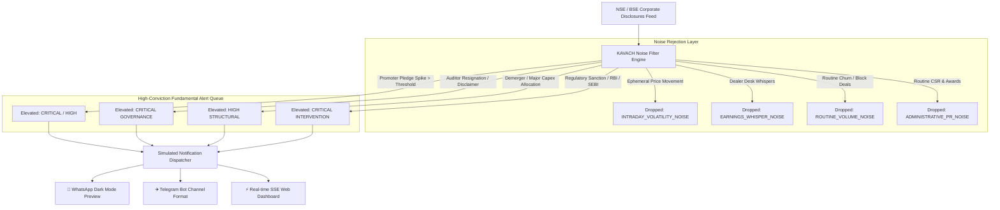

# KAVACH-NSE | Noise-Canceling Long-Term Stock Filter & Alert Engine

An automated, full-stack intelligence prototype built for **long-term Indian equities investors (NSE/BSE)**. It ingests corporate regulatory filings, filters out ephemeral intraday noise (price spikes, whispers, volume anomalies, routine CSR/ESOPs), and surfaces only **high-impact structural changes** (e.g., promoter pledging spikes, auditor resignations, major capital allocation shifts, regulatory freezes).

---

## 🚀 Key Architecture & Components



### 1. The Noise Filter Engine (`backend/src/engine/noiseFilter.js`)
- Automatically drops ephemeral noise:
  - `INTRADAY_VOLATILITY_NOISE`: Suppresses daily price surges/drops (e.g., ±3% to ±8%) lacking corporate balance sheet changes.
  - `EARNINGS_WHISPER_NOISE`: Drops unverified social media rumors and dealer desk notes.
  - `ROUTINE_VOLUME_NOISE`: Discards exchange queries on ordinary block trades or churn.
  - `ADMINISTRATIVE_PR_NOISE`: Drops statutory CSR spend (<0.01% PAT) and marketing awards.
  - `MICRO_DILUTION_NOISE`: Suppresses trivial ESOP exercises.
- Passes high-impact structural signals:
  - **Promoter Pledging Spikes:** Evaluates pledge delta and absolute encumbrance (>40% flagged as Critical).
  - **Auditor Resignations:** Immediately flags premature exits (e.g., Polycab audit dispute).
  - **Capital Allocation Restructuring:** Demergers (e.g., Tata Motors CV/PV split) and massive capex pivots (e.g., Reliance ₹75,000 Cr green energy).
  - **Regulatory Enforcement:** RBI embargoes (e.g., Bajaj Finance EMI lending freeze) or SEBI forensic orders.
  - **Leadership Turmoil:** CFO or Managing Director sudden resignations.

### 2. Modern Terminal Dashboard UI (`frontend/src/`)
- **Telemetry Bar:** Displays real-time noise cancellation efficiency percentage, screen time saved, and count of high-impact signals.
- **Live Alert Feed:** Categorized cards with severity indicators (`CRITICAL`, `HIGH`, `MEDIUM`), fundamental thesis impacts, and recommended due diligence steps.
- **Suppressed Noise View:** Audit log of dropped events explaining *why* they were filtered out.
- **Ticker Audit Modal:** Search any Indian stock (`RELIANCE.NS`, `TATAMOTORS.NS`, `VEDL.NS`, `HDFCBANK.NS`, `INFY.NS`, etc.) to view its historical timeline of structural flags.
- **Custom Filing Injector:** Interactive form to simulate custom filings and see instant filter engine evaluations.
- **Filter Rules Configurator:** Adjust promoter pledge delta thresholds and toggle noise filters on/off.

### 3. Simulated Multi-Channel Notification Dispatcher (`backend/src/engine/dispatcher.js`)
- **WhatsApp Format:** Rich formatted message with bold tickers, severity flags, structural breakdown, and due diligence checklist.
- **Telegram Bot Format:** Clean terminal aesthetic with code tags and direct exchange disclosure links.
- **Real-Time Webhook Simulator:** Live test dispatch with latency measurement (e.g., 94ms) and delivery receipt logging.

---

## 🛠️ Quick Start Guide

### 1. Launch the Engine Backend & Dashboard (Single Port 5000)
The backend is pre-configured to serve the built frontend assets directly:

```powershell
cd backend
node src/server.js
```
Open **[http://localhost:5000](http://localhost:5000)** in your browser.

### 2. (Optional) Run with Hot-Reloading in Development
If you want to edit frontend code with Vite HMR:

```powershell
# Terminal 1: Backend API & SSE Stream
cd backend
npm run dev

# Terminal 2: Vite React Frontend (port 5173 with proxy to 5000)
cd frontend
npm run dev
```

### 3. Run Automated Engine Test Suite
```powershell
cd backend
node test/engine.test.js
```

---

## 📡 REST API Reference

| Endpoint | Method | Description |
|---|---|---|
| `/api/alerts` | `GET` | Returns filtered high-conviction fundamental signals (`?ticker=`, `?severity=`, `?search=`) |
| `/api/noise` | `GET` | Returns suppressed noise feed with cancellation reasons |
| `/api/stats` | `GET` | Returns noise cancellation efficiency, screen time saved, and severity counts |
| `/api/tickers` | `GET` | Returns list of tracked Indian equities with structural health badges |
| `/api/tickers/:symbol/history` | `GET` | Returns complete audit trail (passed vs noise) for a specific stock |
| `/api/simulate/filing` | `POST` | Ingests custom filing, evaluates with filter engine, and broadcasts via SSE |
| `/api/simulate/random` | `POST` | Ingests a random realistic NSE filing |
| `/api/dispatch/logs` | `GET` | Returns multi-channel notification dispatch logs |
| `/api/dispatch/test` | `POST` | Simulates a live test push to WhatsApp / Telegram |
| `/api/config` | `GET` / `POST` | Retrieves or updates engine noise threshold rules |
| `/api/stream` | `GET` | Server-Sent Events (SSE) stream for real-time live ingestion updates |
